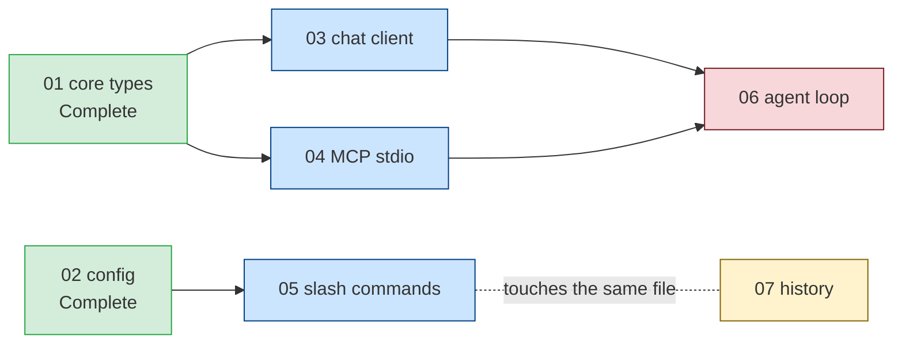
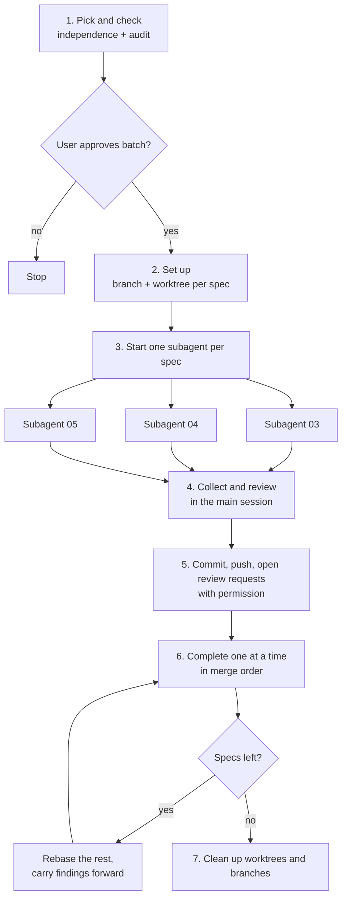
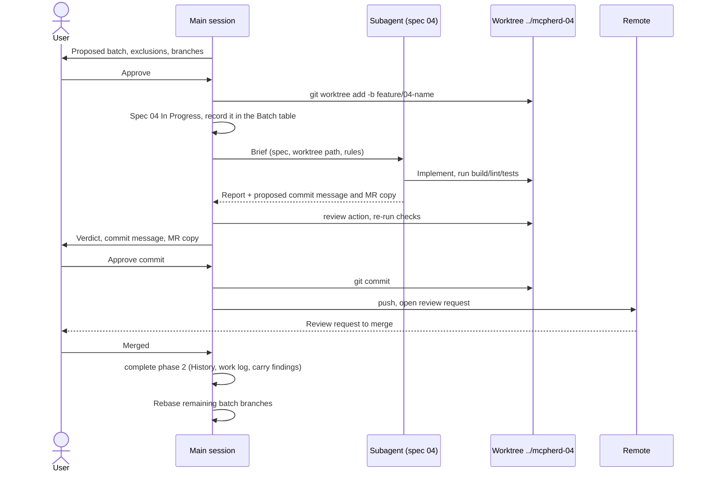
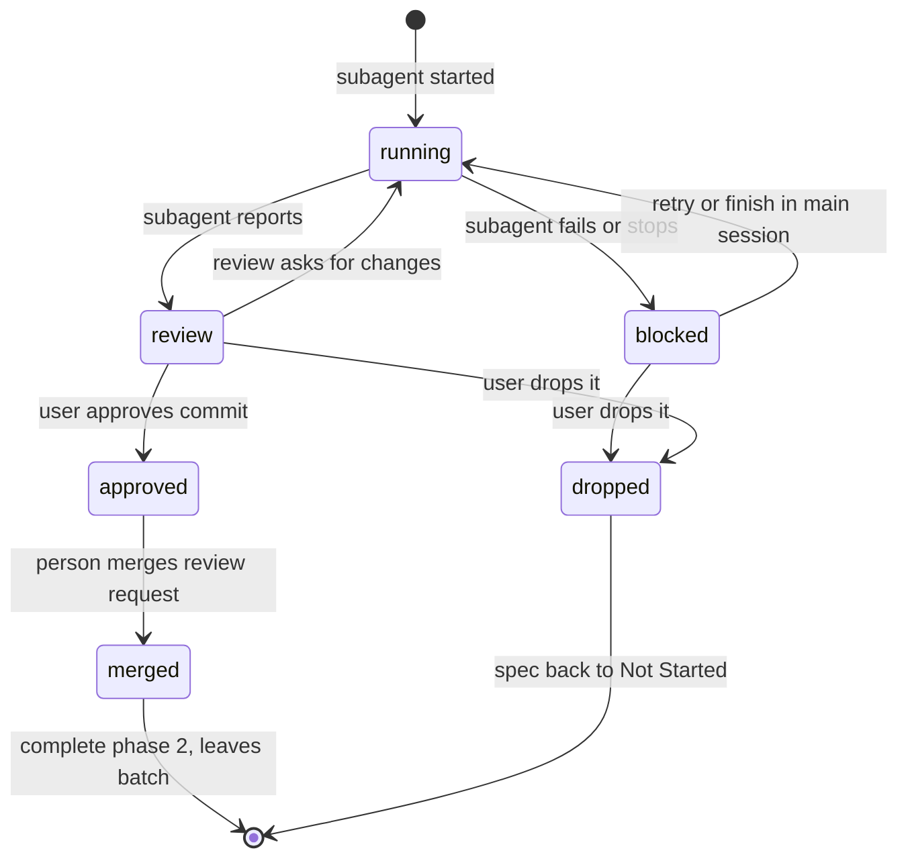
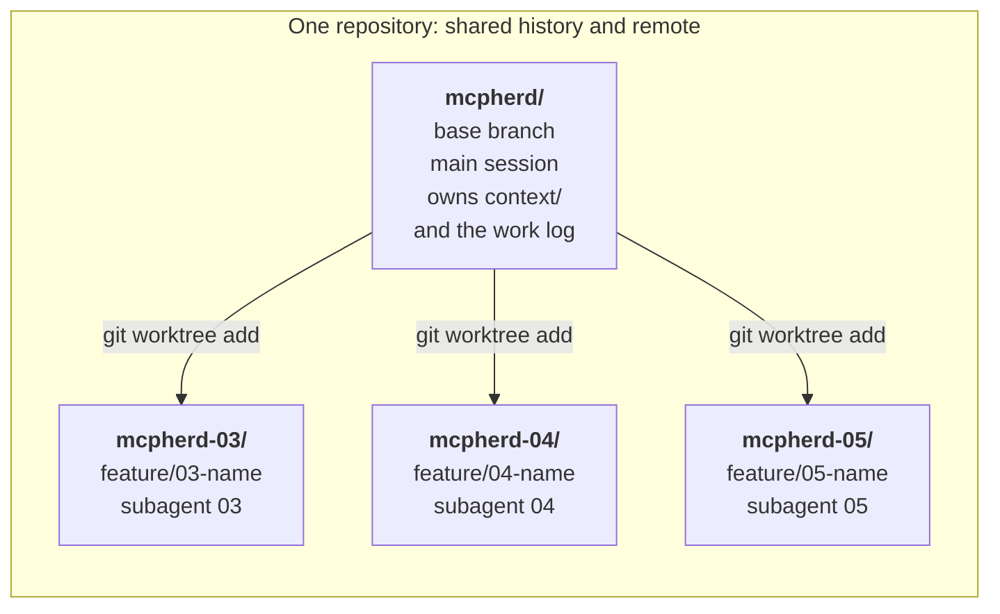

# Feature Skill: Parallel Workflow Plan

**Status:** Draft, not started. Open questions at the end need answers before implementation.

This plan covers changes to the `feature` skill in `.kiro/skills/feature/`. Claude Code reads the
same files through the `.claude/skills/feature` symlink. It is not part of mcpherd itself.

## Goal

Let the skill implement several independent feature specs at the same time. Each spec runs in a
subagent with its own context window, on its own branch, in its own git worktree. A feature
qualifies only if it doesn't depend on unfinished work.

## Non-goals

- Running features that depend on each other. Those still run one after another.
- Letting subagents commit, push, merge or open review requests. Those steps stay in the main
  session and still need the user's explicit permission.
- Merging review requests in parallel. A person still merges each one.

## Why the current skill can't do this

The skill assumes one feature at a time in several places:

| Assumption | Where | What breaks |
| --- | --- | --- |
| One active feature | `context/current-feature.md` holds one H1, one Status, one Goals list | No place to record several active features |
| `In Progress` has a single holder | `SKILL.md` "Spec Files"; `load` step 3 | `load` resets every other `In Progress` spec to `Not Started`, which would undo the rest of a batch |
| One working tree | `start` steps 2–3 check out a branch in the repo | Subagents in one checkout can't be on different branches and would overwrite each other's files |
| History holds one entry | `complete` step 8 | Several completions at once would conflict on `## History` and `docs/work-log.md` |
| Permission before every commit | `SKILL.md` "Constraints"; `ai-interaction.md` step 6 | A subagent usually can't stop mid-run to ask the user |

## Which specs can run in parallel

"No `Depends on:` entries" is not enough. A spec can join a batch only when all of these hold:

1. Every spec on its `Depends on:` line has a `Complete` status line. This is the test `status`
   already uses to pick "next up".
2. No spec in the batch depends on another spec in the same batch, directly or through a chain.
3. No two specs in the batch touch the same files, config keys, commands or test file names. Two
   specs with no dependency between them can still edit the same file and produce merge conflicts.
   `audit` step 3 already has a "Collisions" check that can be reused for this.
4. Each spec passes a single-spec audit (`audit` steps 1–4), as `load` does today.

Specs that fail a check are left out of the batch, and the report says why.

Example. Specs 01 and 02 are complete. Each remaining spec is checked against the batch:



- **03, 04 and 05 qualify** (blue): everything they depend on is complete, and they don't overlap.
- **06 is excluded** (red): it depends on 03 and 04, which are unfinished. It can run after them.
- **07 is excluded** (yellow): it has no dependencies, but its `Touches` section overlaps 05. It
  can run in the next batch, or replace 05 in this one.

Arrows point from a spec to the specs that depend on it. The spec names are placeholders.

## Design: a new `parallel` action

Usage: `feature parallel 04 05 06`. With no list, the action offers every spec that qualifies,
capped at the batch size limit.

### Overview



Only step 3 runs in parallel. Every step that touches shared files or needs permission runs in the
main session.

### Steps

1. **Pick and check.** Read `context/ai-interaction.md` and `context/coding-standards.md`. Apply the
   independence checks above to the requested or offered specs. Show the proposed batch, the
   excluded specs with reasons, and the branch and worktree each will use. Wait for approval.
2. **Set up.** Update the base branch (`git switch <base> && git pull --ff-only`) and check that the
   main working tree is clean. For each spec:
   - create its branch and worktree with `git worktree add <path> -b <branch> <base>`, using the
     branch naming convention in `context/ai-interaction.md`;
   - set the spec's `**Status:**` line to `In Progress`.

   Record the batch in `context/current-feature.md` (see "State changes" below). Each of these git
   steps needs permission, like any other git step in the skill.
3. **Start subagents.** Start one subagent per spec, in parallel. Each gets a brief containing:
   - the spec path and its worktree path;
   - the paths of `context/ai-interaction.md`, `context/coding-standards.md` and
     `context/testing-instructions.md`;
   - the relevant `docs/work-log.md` entries for the spec's dependencies;
   - these rules: work only inside the given worktree; don't edit `context/current-feature.md`,
     `context/feature-history.md`, `docs/work-log.md` or any other spec; don't commit, push or
     delete branches (or the agreed exception, see open questions); run the project's build, lint
     and test commands before finishing; stop and report rather than guess when blocked.

   Each subagent returns:
   - what it built, and any decision that wasn't the obvious choice;
   - anything that deviates from the spec;
   - the checks it ran, with their results;
   - anything left open;
   - a proposed commit message and review request copy, following "Commit Messages and Review
     Requests" in `context/ai-interaction.md`.
4. **Collect and review.** As each subagent finishes, run the `review` action on its worktree in
   the main session. Present all results together, with each verdict. Re-run the checks in each
   worktree rather than trusting the subagent's report.
5. **Commit.** For each branch the user approves, commit in its worktree with the approved message.
   Push and open the review request as in `complete` phase 1, with permission for each.
6. **Complete one at a time.** Run `complete` phase 2 for one spec at a time, in the order the
   review requests merge. After each merge:
   - rebase the remaining batch branches onto the updated base, and report conflicts instead of
     resolving them silently;
   - carry the merged feature's findings into the remaining specs (`complete` step 10). These
     specs were written before their siblings finished, so this step matters more than usual.
7. **Clean up.** After every spec in the batch has completed or been dropped, ask before removing
   each worktree (`git worktree remove <path>`) and deleting the local branches. Clear the batch
   record.

### Who does what

The user approves, the main session coordinates and owns shared files, and each subagent works
only in its own worktree. One spec is shown; the others run the same way at the same time.



### Fallback

If the tool can't run subagents, the action works through the batch one spec at a time, in the
main session, using the same steps. `audit` step 5 already falls back the same way.

### Failure handling

- **Subagent fails or gets blocked:** keep its worktree and branch, mark it as blocked in the batch
  record, and report what it tried. The user chooses to retry it, finish it in the main session, or
  drop it.
- **Dropped spec:** reset its `**Status:**` line to `Not Started`, remove it from the batch record,
  and ask before removing its worktree and branch.
- **Review requested changes:** fix them in that spec's worktree, in the main session or a new
  subagent, then review again.

## State changes

`context/current-feature.md` gets an optional `## Batch` section, present only during a parallel
run:

```markdown
## Batch

| Spec | Branch | Worktree | State |
| --- | --- | --- | --- |
| context/features/04-name.md | feature/04-name | ../mcpherd-04-name | running |
| context/features/05-name.md | feature/05-name | ../mcpherd-05-name | review |
```

State values: `running`, `blocked`, `review`, `approved`, `merged`, `dropped`.



While a batch is active, the H1 reads `# Current Feature: Batch (04, 05, 06)`, and Goals lists
each spec's goals under its own name.

Rules that change:

- **`SKILL.md`, "Spec Files":** `In Progress` has a single holder, unless every holder is listed
  under `## Batch`. A marker that is in neither place is still stale.
- **`load`:** don't reset `In Progress` markers listed under `## Batch`. Refuse to load a single
  feature while a batch is active, unless the user drops the batch first.
- **`status`:** report one line per batch spec with its state, and check that the batch record
  matches `git worktree list`.
- **`complete`:** accept a spec name when a batch is active, work in that spec's worktree, and
  remove the spec from the batch record when it finishes. `## History` still gets one entry per
  completion, in merge order.

## Tool support

Both Claude Code and Kiro can run subagents with separate context windows.

- **Claude Code** can give custom subagents their own worktree with `isolation: worktree` in the
  agent's frontmatter. Two caveats: the worktree starts from the default branch rather than the
  current one, and an open bug report says the isolation isn't applied to subagents defined in a
  plugin ([anthropics/claude-code#34775](https://github.com/anthropics/claude-code/issues/34775)).
- **Kiro** subagents share the workspace, so the skill has to supply the worktree.

Plan: the skill creates every worktree itself with `git worktree add` and passes the path to the
subagent. That behaves the same in both tools and doesn't depend on either tool's isolation
feature. The action file describes subagents in tool-neutral terms ("if the tool supports
sub-agents"), as `audit` does.

The resulting layout, assuming worktrees sit next to the repo (open question 1):



Each worktree is a separate folder on its own branch, so subagents never share files. The shared
`context/` files are edited only in the main checkout. Folder names are shortened here; the real
ones would follow the spec names, such as `../mcpherd-03-chat-client`.

## Risks

- **Merge conflicts despite the checks.** The collision check reads specs, not future code. Keeping
  the batch small and rebasing after each merge limits the damage.
- **Findings arrive late.** In a sequential run, each spec gets the previous feature's findings
  before work starts. In a batch, siblings learn from each other only after they finish. Step 6
  carries the findings forward, but some rework is possible.
- **Review load.** Each spec is a separate review request. The batch size limit keeps that
  manageable.
- **Cost.** Each subagent rereads the context files and the code it touches.
- **Shared resources.** Tests that use a fixed port, a shared database or a shared temp folder can
  fail when run at the same time in several worktrees. `context/testing-instructions.md` should say
  whether the test suite is safe to run in parallel.
- **Leftover worktrees.** An interrupted run can leave worktrees behind. `status` reporting
  mismatches with `git worktree list` covers this.

## Prerequisites (done 2026-10-30)

These changes to the skill are in place. The parallel action builds on them.

1. **Spec path in `current-feature.md`.** `load` writes a `**Spec:** <path>` line under the H1, and
   `start`, `review`, `explain`, `complete` and `abandon` read it. The batch table generalizes this
   line.
2. **Spec template.** `templates/spec.md` defines Context, Goals, Acceptance Criteria, Non-goals,
   Touches, Notes and Testing. `plan` and `load` create specs from it, and `audit` and `complete`
   use its section names. The independence check reads the `Touches` section, which `audit` keeps
   current.
3. **`status` patterns.** `SKILL.md` "Spec Files" defines recursive, anchored patterns that work in
   zsh with empty folders and include `context/fixes/`. `status`, `audit`, `load` and `complete`
   use them.
4. **`review` action.** It reviews `git diff <base>...HEAD` plus uncommitted work against the spec
   and `context/coding-standards.md`, runs the project's checks, and reports a verdict, goal by goal
   status and ranked issues.

## Implementation order

1. `## Batch` section and the rule changes in `SKILL.md`, `load`, `status`, `complete` and
   `abandon`.
2. `actions/parallel.md`. The "dropped spec" handling can follow `actions/abandon.md`.
3. Update the action table in `SKILL.md`, the action list in `README.md`, and the
   `description` field in `SKILL.md`'s frontmatter so tools offer the skill for parallel requests.
4. Trial run on two small, clearly independent specs. Check both tools.

## Open questions

1. **Worktree location:** a folder next to the repo (`../mcpherd-04-name`), or one inside it that
   git ignores (such as `.worktrees/04-name`)?
2. **Commits:** may subagents commit locally on their own branch, never pushing, to make handoff
   easier? Or does the main session make every commit? Local commits would need an explicit
   exception to the "permission before committing" rule, granted once when the batch is approved.
3. **Batch size limit:** suggested default is 3.
4. **Completion:** one completion request per spec (current behavior, more review requests), or a
   single completion request after the whole batch has merged?
5. **Test isolation:** should `setup` record in `context/testing-instructions.md` whether the test
   suite is safe to run in several worktrees at once?
