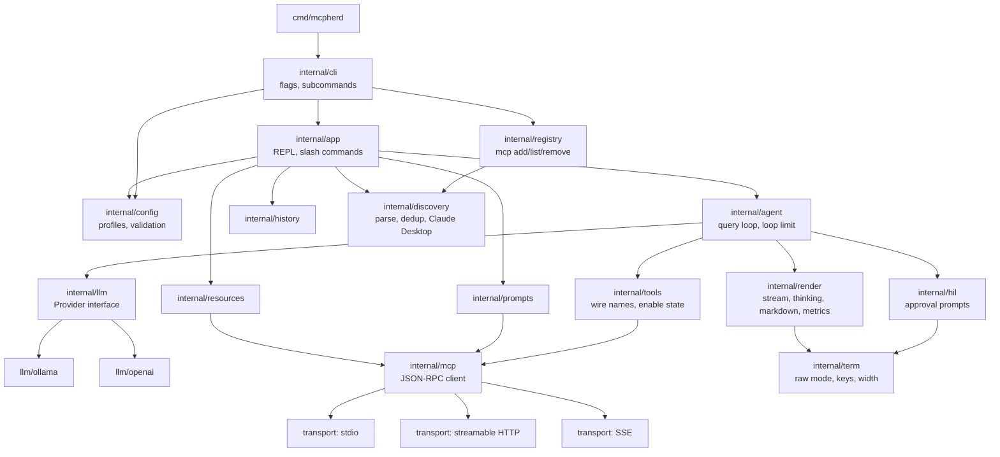
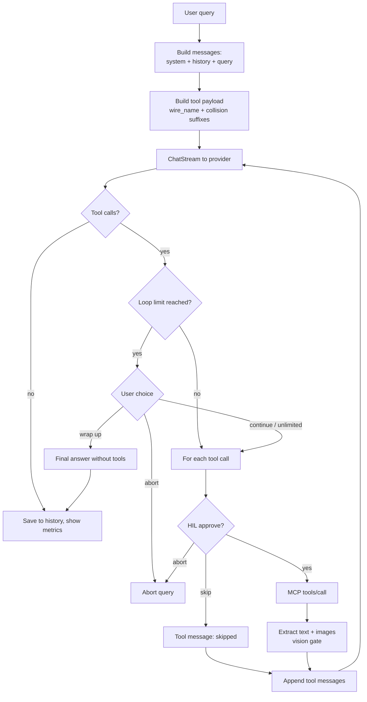
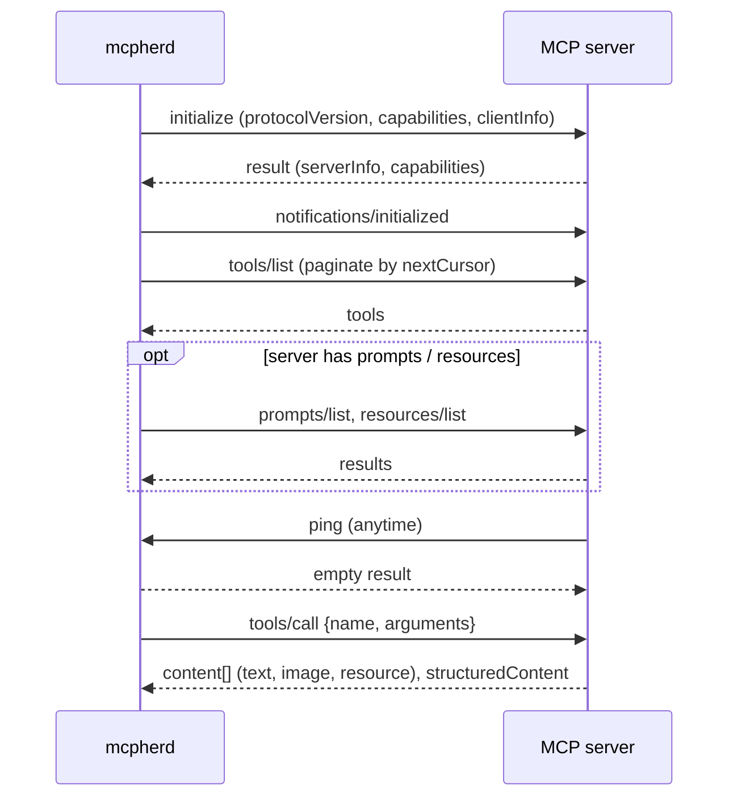
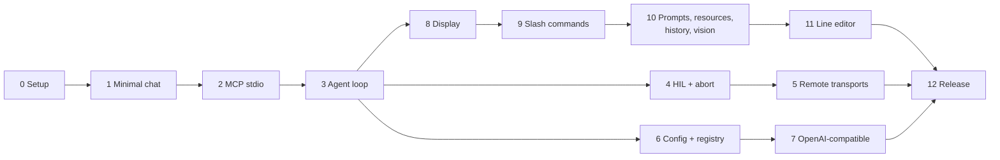
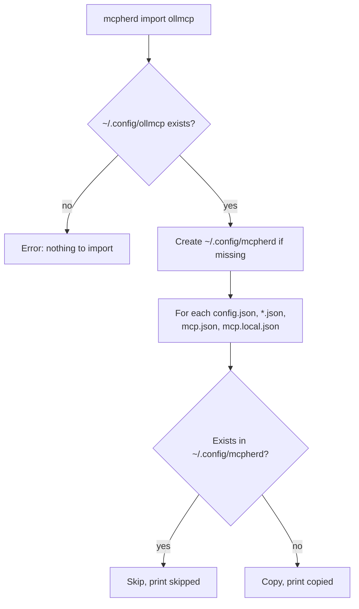

# mcpherd: Go Port Plan

`mcpherd` is a Go reimplementation of an existing Python MCP client ([source](https://github.com/jonigl/mcp-client-for-ollama), ~9.4k lines of Python, ~5k lines of tests), preferring the standard library. File and test names below (`client.py`, `test_*.py`) refer to that codebase.

- Module: `github.com/shaynemeyer/mcpherd`
- Binary: `mcpherd`

## Goals

- Use the standard library by default. External modules are allowed only where hand-rolling costs more than it gains.
- Keep its own files in `~/.config/mcpherd/` (`config.json`, named configs, `mcp.json`, `mcp.local.json`, `logs/`), using the same JSON formats as the Python version. The project-scope `.mcp.json` stays in the project root, shared with other MCP clients such as Claude Code.
- Import an existing setup from `~/.config/ollmcp/` only when the user runs `mcpherd import ollmcp` (see Phase 6). Never write to the source files.
- Work incrementally: every phase ends with something that runs and has tests ported from the Python suite.

## Dependency policy

| Concern                  | Choice                                                                                                                | Reason                                                                                                                                  |
| ------------------------ | --------------------------------------------------------------------------------------------------------------------- | --------------------------------------------------------------------------------------------------------------------------------------- |
| Ollama client            | stdlib: `net/http`, `encoding/json`, `bufio`                                                                          | Four endpoints, NDJSON streaming. [Ollama API](https://github.com/ollama/ollama/blob/main/docs/api.md)                                  |
| OpenAI-compatible client | stdlib: `net/http` + small SSE parser                                                                                 | One endpoint (`/chat/completions`) plus `/models`                                                                                       |
| CLI                      | stdlib `flag`, one `FlagSet` per subcommand                                                                           | Only `mcpherd`, `mcpherd mcp add/list/remove` and `mcpherd import ollmcp`                                                               |
| Colors, tables, panels   | ANSI escape codes + `text/tabwriter`                                                                                  | Simple                                                                                                                                  |
| MCP over stdio           | Own JSON-RPC 2.0 client on `os/exec`                                                                                  | Small, well-defined transport                                                                                                           |
| MCP over HTTP/SSE        | **Decide at Phase 5**: own client or [official go-sdk](https://pkg.go.dev/github.com/modelcontextprotocol/go-sdk/mcp) | Keeping up with the spec is the main cost. [Transports spec](https://modelcontextprotocol.io/specification/2025-06-18/basic/transports) |
| Raw terminal mode        | [`golang.org/x/term`](https://pkg.go.dev/golang.org/x/term)                                                           | Go team module; avoids per-OS ioctl code and the Windows console API                                                                    |
| Line editing             | Plain line reader first; own editor in Phase 11                                                                       | Autocomplete menus are the costliest feature to hand-roll                                                                               |
| Markdown output          | Own minimal renderer (headings, emphasis, code, lists)                                                                | Full Glamour parity is not a goal                                                                                                       |

Expected external modules: **1–2** (`x/term`, and maybe `go-sdk`).

## Architecture



### Key interfaces

```go
// Provider is an LLM backend.
type Provider interface {
    ListModels(ctx context.Context) ([]Model, error)
    Capabilities(ctx context.Context, model string) ([]string, error)
    ChatStream(ctx context.Context, req ChatRequest, fn func(Chunk) error) error
}

// Transport moves JSON-RPC messages to and from one MCP server.
type Transport interface {
    Send(ctx context.Context, msg []byte) error
    Receive(ctx context.Context) ([]byte, error)
    Close() error
}
```

## Agent loop

This is the port of `process_query` (`client.py:559`).



## MCP client handshake



A listing call that kills the connection is retried without that capability, as `_attempt_connection` does (`server/connector.py:173`). Stdio server stderr goes to the log file, never to the screen (issue #293).

## Phases



Each phase lists what it builds, which Python code it ports, and how to check it.

### Phase 0: Setup

- `go mod init`, `cmd/mcpherd/main.go`, `internal/` layout, `go test ./...` and `go vet` in CI.
- Check: `go build` and an empty test run pass.

### Phase 1: Minimal chat (stdlib only)

- `--model`, `--host` with `flag`; plain `bufio` input loop; `llm/ollama` with `/api/chat` streaming and `/api/tags`.
- Check: chat with `qwen3:0.6b`; a unit test parses NDJSON chunks from an `httptest.Server`.

### Phase 2: MCP stdio client (stdlib only)

- `internal/mcp`: JSON-RPC 2.0 framing, request ID to response channel map, notifications, `initialize`, `tools/list` pagination, answering `ping`, "method not found" for other server requests.
- `transport/stdio` on `os/exec` with newline-delimited JSON; stderr to the log file.
- `internal/discovery`: `--mcp-server`, `--servers-json`, `mcpServers` parsing.
- Ports: `server/discovery.py`, part of `server/connector.py`, `utils/server_logs.py`.
- Check: `test_server_discovery.py` cases; connect to a real Python and Node server and list tools.

### Phase 3: Agent loop

- `wire_name` + `build_tool_payload` (collision suffixes), tool dispatch by `server.tool`, loop limit choices, `_extract_tool_response` (text, images, structured content).
- Ports: `tools/manager.py` (non-UI part), `client.py:559-870`.
- Check: `test_tool_wire_names.py`, `test_structured_content_forwarding.py`; a multi-tool query end to end.

### Phase 4: Human-in-the-loop and abort

- `internal/term` on `x/term` (raw mode, single key reads); HIL prompt with per-session auto-execute.
- Abort with `context.WithCancel`, driven by a key listener goroutine that pauses during HIL prompts (replaces the `termios` monitor and `monitor_paused_ack`).
- Check: `test_hil_session.py`, `test_quit_signal_routing.py`, `test_cleanup_race_condition.py` cases.

### Phase 5: Remote transports

- **Decision point:** write streamable HTTP and SSE yourself, or switch `internal/mcp` to the official go-sdk behind the same interface. Prototype streamable HTTP for one day, then decide.
- Headers from config, `Mcp-Session-Id`, JSON or SSE replies; `deduplicate_servers`; Claude Desktop discovery; capability-drop retry.
- Check: `test_connector.py`, `test_connector_server_dedup.py`, `test_connector_e2e.py` cases.

### Phase 6: Config and registry

- `ConfigManager` (provider profiles, validation, name sanitizing), scoped registry with `local > project > user` precedence, `mcpherd mcp add/list/remove`.
- Config directory: `~/.config/mcpherd/`, created on first use with defaults. Startup never reads `~/.config/ollmcp/`.
- `mcpherd import ollmcp`: copy `config.json`, named config `*.json`, `mcp.json` and `mcp.local.json` (not `logs/`) from `~/.config/ollmcp/`. Copy, don't move, so the source setup keeps working. Never overwrite: a file that already exists in `~/.config/mcpherd/` is skipped. Print each file as copied or skipped. Exit with an error if `~/.config/ollmcp/` does not exist.
- Check: `test_config_manager.py`, `test_mcp_registry.py`, `test_mcp_cli_commands.py`; a config saved by the Python version loads in Go; import tests on a temp `$HOME` (no source setup, fresh import, some files already present).



### Phase 7: OpenAI-compatible providers (stdlib only)

- `llm/openai`: `/chat/completions` with SSE, rebuilding streamed tool-call arguments, `/models`; default base URLs per provider; API key order: flag, then `$MCPHERD_API_KEY`, then profile; reasoning effort mapping.
- Ports: `utils/connection.py`, `models/manager.py`, `models/config_manager.py` (completion kwargs).
- Check: `test_reasoning_effort.py`, `test_api_key_persistence.py`; one real OpenRouter call.

### Phase 8: Display

- Thinking display, render modes (plain, markdown, both, blocks), tool execution display, metrics, control-character sanitizing.
- Minimal markdown-to-ANSI renderer; terminal width from `x/term`.
- Check: `test_streaming_manager.py` (most important suite), `test_sanitize.py`, `test_query_progress.py`.

### Phase 9: Slash commands and menus

- All commands in `INTERACTIVE_COMMANDS` plus aliases; numbered-list menus for model, tools, model options, reasoning effort, display mode.
- Check: `test_slash_command_execution.py`, `test_client_input_routing.py`, `test_model_manager.py`.

### Phase 10: Prompts, resources, history, vision

- MCP prompts (argument collection, preview, rollback), `@resource` injection, history export/import, image forwarding to vision models.
- Check: `test_prompt_manager.py`, `test_prompt_handler.py`, `test_resources.py`, `test_resource_parser.py`.

### Phase 11: Line editor

- Own editor on `internal/term`: cursor movement, history, fuzzy completion menu (`MAX_COMPLETION_MENU_ROWS`), multiline mode, contextual prompt, bottom toolbar.
- Check: `test_fzf_style_completion.py` cases (matching logic tested separately from drawing).

### Phase 12: Release

- Cross-compiled binaries (`GOOS`/`GOARCH` matrix in CI), update check against GitHub releases instead of PyPI.
- Concise README; keep the existing Credits section and `LICENSE` notices (see Credits and licensing).

## Risks

| Risk                                                                        | Mitigation                                                                                            |
| --------------------------------------------------------------------------- | ----------------------------------------------------------------------------------------------------- |
| MCP spec changes (logging/`setLevel` deprecated in the 2026-07-28 revision) | Keep `internal/mcp` behind an interface; decide on go-sdk at Phase 5; consider dropping `--log-level` |
| Streaming output and raw-mode key reading interfere                         | Prototype in Phase 4 before building the line editor                                                  |
| Windows terminal behavior                                                   | Rely on `x/term`; test on Windows CI from Phase 4                                                     |
| `client.py` is a 2.3k-line class                                            | Split by responsibility (packages above), not a line-by-line port                                     |
| Line editor scope                                                           | Leave it last; every earlier phase works with a plain reader                                          |

## Credits and licensing

Done: the README's Credits section holds the acknowledgment, and `LICENSE` carries the original
project's MIT notice next to mcpherd's. Keep both as they are; don't repeat them elsewhere.

### Name check (2026-10-29)

`mcpherd`: it herds MCP servers, with a nod to llamas.

| Where      | Result                                                          |
| ---------- | --------------------------------------------------------------- |
| GitHub     | No repos named `mcpherd`; `github.com/shaynemeyer/mcpherd` free |
| pkg.go.dev | No modules matching `mcpherd`                                   |
| Homebrew   | No `mcpherd` formula                                            |

Not checked: trademarks, or projects outside GitHub. Rejected names: `llamux` (five small local-LLM projects share it), `ollama-shepard` (spelling, implies Ollama affiliation), `tether`, `burrow`, `paddock` (taken by established projects).
