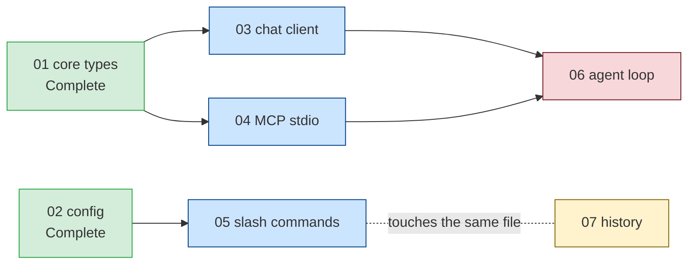
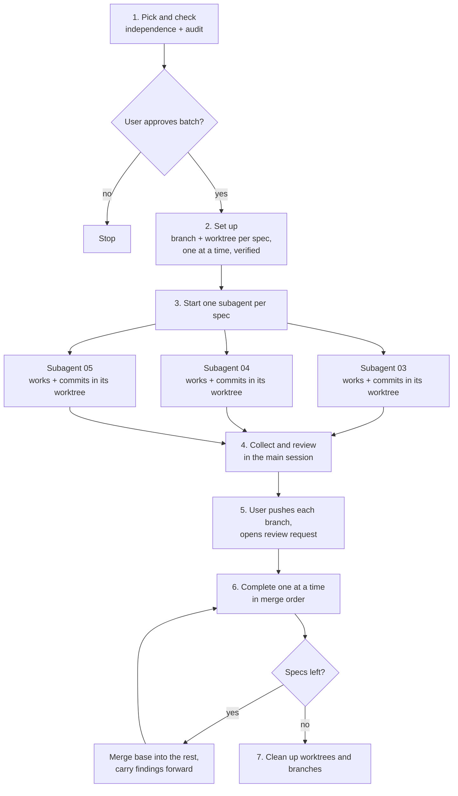
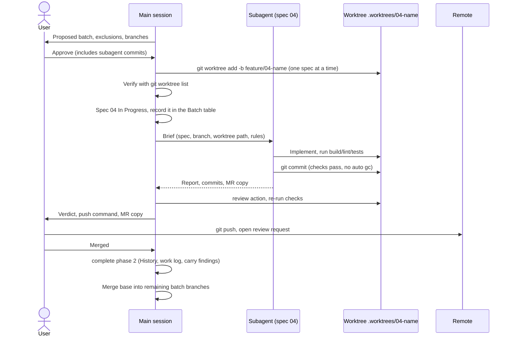
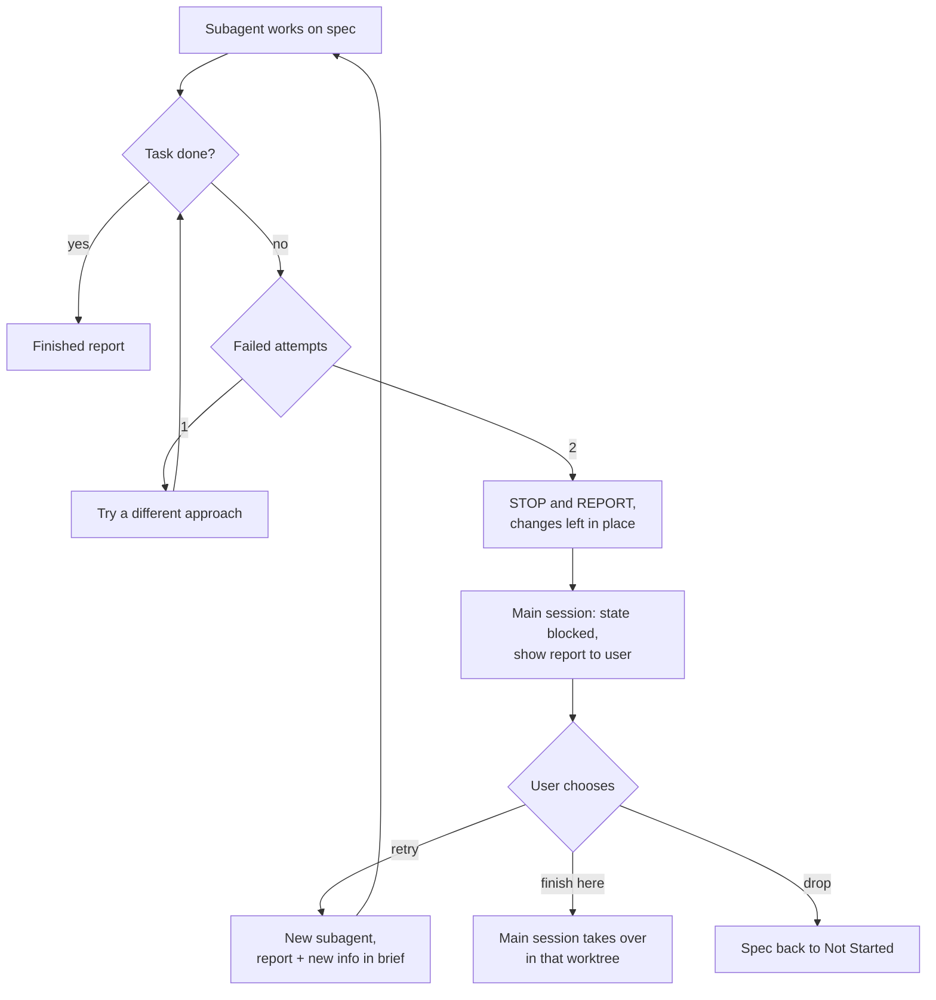
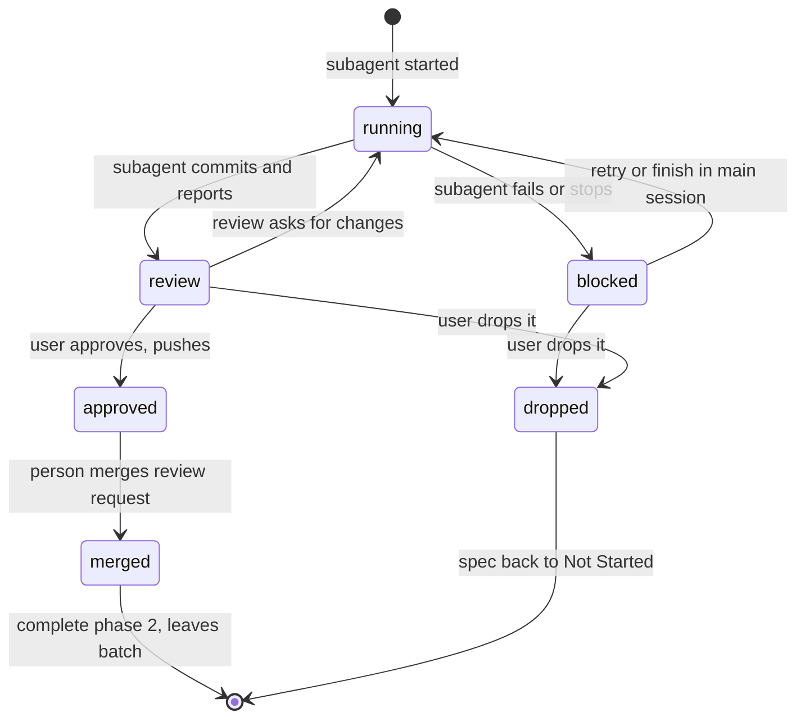
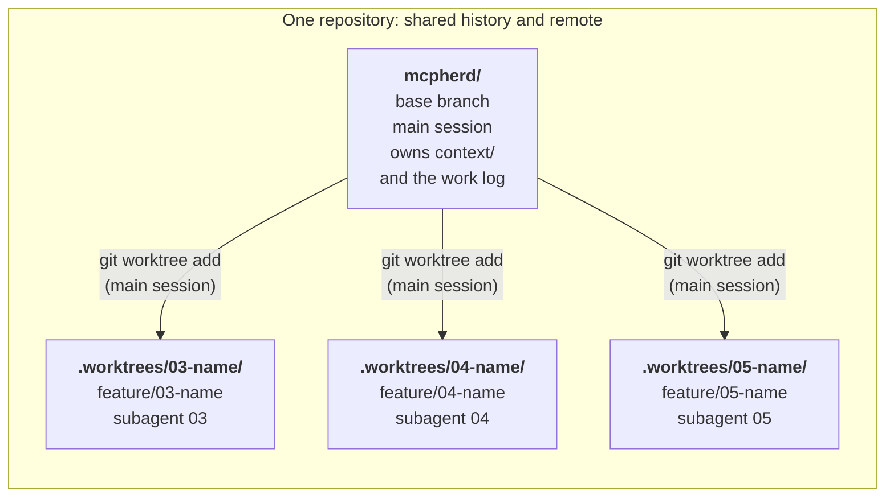

# Feature Skill: Parallel Workflow Plan

**Status:** Implemented 2026-10-30 (implementation order steps 1–5). Step 6, the trial run in
both tools, is still to do.

This plan covers changes to the `feature` skill in `.kiro/skills/feature/`. Claude Code reads the
same files through the `.claude/skills/feature` symlink. It is not part of mcpherd itself.

## Goal

Let the skill implement several independent feature specs at the same time. Each spec runs in a
subagent with its own context window, on its own branch, in its own git worktree. A feature
qualifies only if it doesn't depend on unfinished work.

## Non-goals

- Running features that depend on each other. Those still run one after another.
- Letting subagents push, merge or open review requests. The user pushes each branch; the main
  session prepares the review request copy. Subagents do commit to their own branches, which the
  main session creates for them (see "Decisions").
- Merging review requests in parallel. A person still merges each one.

## Why the current skill can't do this

The skill assumes one feature at a time in several places:

| Assumption | Where | What breaks |
| --- | --- | --- |
| One active feature | `context/current-feature.md` holds one H1, one Status, one Goals list | No place to record several active features |
| `In Progress` has a single holder | `SKILL.md` "Spec Files"; `load` step 3 | `load` resets every other `In Progress` spec to `Not Started`, which would undo the rest of a batch |
| One working tree | `start` steps 2–3 check out a branch in the repo | Subagents in one checkout can't be on different branches and would overwrite each other's files |
| History holds one entry | `complete` step 8 | Several completions at once would conflict on `## History` and `docs/work-log.md` |
| Permission before every commit | `SKILL.md` "Constraints"; `ai-interaction.md` step 6 | A subagent usually can't stop mid-run to ask the user |

## Which specs can run in parallel

"No `depends_on` entries" is not enough. A spec can join a batch only when all of these hold. Each
check reads spec frontmatter through `scripts/spec-fields.sh`:

1. Every spec in its `depends_on` is `Complete` (`status`). This is the test `next` already uses.
2. No spec in the batch depends on another spec in the same batch, directly or through a chain
   (`order` lists the specs in dependency order).
3. No two specs in the batch have overlapping `touches`: `overlaps <id> <id> <id>` prints nothing.
   Two specs with no dependency between them can still edit the same file and produce merge
   conflicts. A folder in `touches` overlaps every path inside it.
4. Each spec passes a single-spec audit (`audit` steps 1 and 3–5), as `load` does today. That
   includes `check`, so old-format or malformed specs are excluded until fixed.

Specs that fail a check are left out of the batch, and the report says why.

Example. Specs 01 and 02 are complete. Each remaining spec is checked against the batch:



- **03, 04 and 05 qualify** (blue): everything they depend on is complete, and they don't overlap.
- **06 is excluded** (red): it depends on 03 and 04, which are unfinished. It can run after them.
- **07 is excluded** (yellow): it has no dependencies, but its `touches` overlaps 05's. It
  can run in the next batch, or replace 05 in this one.

Arrows point from a spec to the specs that depend on it. The spec names are placeholders.

## Design: a new `parallel` action

Usage: `feature parallel 04 05 06`. With no list, the action offers every spec that qualifies,
up to 3, the batch size limit.

### Overview



Only step 3 runs in parallel. Subagents touch only their own worktree and commit only to its
branch. Every git command that touches shared state, and every step that touches shared files, runs
in the main session one at a time, and only the user pushes.

### Steps

1. **Pick and check.** Read `context/ai-interaction.md`, `context/coding-standards.md` and
   `context/testing-instructions.md`. If its "Parallel Safety" section says the test suite can't
   run in several worktrees at once, stop and report that the batch can't run. Apply the
   independence checks above to the requested or offered specs, up to the batch size limit of 3.
   Show the proposed batch, the excluded specs with reasons, and the branch and worktree each will
   use. Wait for approval. Approving the batch also grants each subagent permission to commit to
   its branch (see "Decisions").
2. **Set up.** Update the base branch (`git switch <base> && git pull --ff-only`), check that the
   main working tree is clean, and record the base commit's sha. Check that `.worktrees/` is
   ignored (`git check-ignore -q .worktrees/x`); if not, add it to `.gitignore` and stop to have
   that change committed first. Then, one spec at a time:
   - choose its branch name, following the naming convention in `context/ai-interaction.md`, and
     its worktree path, `.worktrees/<nn-name>`;
   - check that neither exists yet (`git rev-parse --verify --quiet refs/heads/<branch>` finds
     nothing, and the path is absent). If either exists, stop and report it: it is usually a
     leftover from an earlier run;
   - create both with `git worktree add .worktrees/<nn-name> -b <branch> <base sha>`;
   - set the spec's `**Status:**` line to `In Progress`.

   After the last one, check that `git worktree list` shows every worktree on its branch at the
   base sha, and record the batch in `context/current-feature.md` (see "State changes" below). Any
   failure here is reported before a subagent starts, and each git step follows "When Stuck".
3. **Start subagents.** Start one subagent per spec, in parallel. Each gets a brief containing:
   - the spec path, its branch name, and its worktree path, which already exists and has the branch
     checked out;
   - the paths of `context/ai-interaction.md`, `context/coding-standards.md` and
     `context/testing-instructions.md`;
   - the relevant `docs/work-log.md` entries for the spec's dependencies;
   - these rules: work only inside the given worktree; don't edit `context/current-feature.md`,
     `context/feature-history.md`, `docs/work-log.md` or any other spec; run the project's build,
     lint and test commands, and commit to its branch only when they pass, following "Commit
     Messages and Review Requests" in `context/ai-interaction.md`;
   - the git rules in "Git in a shared repository" below;
   - the stuck rule, "When Stuck" in `context/ai-interaction.md`: after two failed attempts at a
     task, STOP and REPORT instead of trying again (see "When a subagent gets stuck" below).

   Each subagent returns one of two reports. A finished report covers:
   - what it built, and any decision that wasn't the obvious choice;
   - anything that deviates from the spec;
   - the checks it ran, with their results;
   - anything left open;
   - its commits (sha and subject), and proposed review request copy following "Commit Messages
     and Review Requests" in `context/ai-interaction.md`.

   A blocked report follows the format in "When Stuck" in `context/ai-interaction.md`. A blocked
   subagent doesn't commit: its changes stay uncommitted in the worktree.
4. **Collect and review.** As each subagent finishes, run the `review` action on its branch in
   the main session. Present all results together, with each verdict. Re-run the checks in each
   worktree rather than trusting the subagent's report. Blocked specs are presented with their
   reports, and the user decides what happens to each one.
5. **Push and open review requests.** For each branch the user approves, ask the user to push it,
   giving the exact command (`git push -u <remote> <branch>`), and give the review request title
   and description to paste. Fixes requested by the review are made as new commits on that branch
   before the push.
6. **Complete one at a time.** Run `complete` phase 2 for one spec at a time, in the order the
   review requests merge. Each spec gets its own completion request, as `complete` does today.
   After each merge:
   - bring the remaining batch branches up to date by merging the updated base into each one, in
     its worktree. Don't rebase them: they are already pushed, and a rebase would need a force
     push. Report conflicts instead of resolving them silently, and ask the user to push each
     updated branch;
   - carry the merged feature's findings into the remaining specs (`complete` step 10). These
     specs were written before their siblings finished, so this step matters more than usual.
7. **Clean up.** After every spec in the batch has completed or been dropped, ask before removing
   each worktree (`git worktree remove .worktrees/<nn-name>`) and deleting the local branches.
   Clear the batch record.

### Who does what

The user approves and pushes, the main session coordinates, creates every branch and worktree, and
owns shared files, and each subagent works in and commits to only its own worktree and branch. One
spec is shown; the others run the same way at the same time.



### Git in a shared repository

All worktrees share one `.git` folder. Commits on different branches in different worktrees mostly
don't block each other: each worktree has its own index, `HEAD` and branch. What collides is a
command that writes a file every worktree shares. These rules go in every subagent brief:

- **Allowed:** `git status`, `git diff`, `git log`, `git add` and `git commit`, inside its own
  worktree only.
- **Commit without automatic cleanup:** run commits as
  `git -c gc.auto=0 -c maintenance.auto=false commit ...`. Git can otherwise start `gc` or
  maintenance after a commit, which locks and repacks the shared object store. The `-c` flags apply
  to that one command and don't change git config.
- **Not allowed:** `stash` (one `refs/stash` is shared by every worktree), `fetch`, `pull`, `push`,
  `merge`, `rebase`, `reset`, `checkout` or `switch` of another branch, `branch -d`/`-D`, `gc`,
  `config`, `pack-refs` and `worktree add`/`remove`.
- **Never delete a `.lock` file.** A lock file can belong to a git command that is still running,
  and removing it can corrupt the repository.
- **Lock errors follow "When Stuck".** The failed command is the first attempt. The second is one
  retry after waiting a few seconds. If that fails too, STOP and REPORT, leaving the changes
  uncommitted.

The main session runs every command that touches shared state (creating worktrees, `pull`, merging
the base into branches, removing worktrees) one at a time. While any subagent is still running, the
main session uses only read-only git commands, such as the `diff` and `log` that `review` needs.

### Fallback

If the tool can't run subagents, the action works through the batch one spec at a time, in the
main session, using the same steps. `audit` step 6 already falls back the same way.

### Failure handling

#### When a subagent gets stuck

A subagent can't ask the user anything mid-run, so without a limit it may keep trying variations
of a failing approach and use up its context. The rule is "When Stuck" in
`context/ai-interaction.md`, the same one the main session follows: **after two failed attempts,
STOP and REPORT.**

- **Two failed attempts, then STOP.** A failed attempt is an approach that ends without the task
  done: the build or a test still fails, the same error comes back, or the code doesn't behave as
  the spec needs. After the second, the subagent stops. It doesn't try a third approach or repeat
  a failed one with small changes.
- **REPORT.** It ends its run with the report "When Stuck" describes: the task and where it
  stopped, each attempt and why it was expected to work, the failing command with the relevant
  output and file and line references, the files it changed (left in place, uncommitted), its best
  guess at the cause, and the decision or information needed to continue.
- **No cleanup.** It leaves its changes in the worktree as evidence.

The main session then:

1. Sets the spec's state to `blocked` in the batch table.
2. Keeps the worktree and branch.
3. Shows the user the blocked report next to the other results in step 4. It doesn't restart the
   subagent with the same brief.
4. Acts on the user's choice:
   - **Retry:** start a new subagent with the report and the user's new information added to the
     brief. The new subagent gets its own two attempts.
   - **Finish in the main session:** pick up the work in that worktree. The main session follows
     the same rule: two more failed attempts, and it STOPS and REPORTS to the user.
   - **Drop:** see "Dropped spec" below.



#### Other failures

- **Subagent fails for another reason** (crashes, runs out of context, or returns no report): keep
  its worktree and branch, mark it as blocked in the batch record, and report what the worktree
  shows it did. The user makes the same choice as above.
- **Dropped spec:** reset its `**Status:**` line to `Not Started`, remove it from the batch record,
  and ask before removing its worktree and branch.
- **Review requested changes:** fix them in that spec's worktree, in the main session or a new
  subagent, then review again. The two-attempt rule applies to the fixes too.

## State changes

`context/current-feature.md` gets an optional `## Batch` section, present only during a parallel
run:

```markdown
## Batch

| Spec | Branch | Worktree | State |
| --- | --- | --- | --- |
| context/features/04-name.md | feature/04-name | .worktrees/04-name | running |
| context/features/05-name.md | feature/05-name | .worktrees/05-name | review |
```

State values: `running`, `blocked`, `review`, `approved`, `merged`, `dropped`.



While a batch is active, the H1 reads `# Current Feature: Batch (04, 05, 06)`, and Goals lists
each spec's goals under its own name.

Rules that change:

- **`SKILL.md`, "Spec Files":** `In Progress` has a single holder, unless every holder is listed
  under `## Batch`. A marker that is in neither place is still stale.
- **`load`:** don't reset `In Progress` markers listed under `## Batch`. Refuse to load a single
  feature while a batch is active, unless the user drops the batch first.
- **`status`:** report one line per batch spec with its state, and check that the batch record
  matches `git worktree list`.
- **`complete`:** accept a spec name when a batch is active, work in that spec's worktree, and
  remove the spec from the batch record when it finishes. `## History` still gets one entry per
  completion, in merge order.

## Tool support

Both Claude Code and Kiro can run subagents with separate context windows.

- **Claude Code** can give custom subagents their own worktree with `isolation: worktree` in the
  agent's frontmatter. Two caveats: the worktree starts from the default branch rather than the
  current one, and an open bug report says the isolation isn't applied to subagents defined in a
  plugin ([anthropics/claude-code#34775](https://github.com/anthropics/claude-code/issues/34775)).
- **Kiro** subagents share the workspace, so the skill has to supply the worktree.

Plan: the main session creates every worktree itself with `git worktree add`, one spec at a time,
checks the result, and passes the path to the subagent. That behaves the same in both tools and
doesn't depend on either tool's isolation feature. The action file describes subagents in
tool-neutral terms ("if
the tool supports sub-agents"), as `audit` does.

Worktrees go in `.worktrees/<nn-name>` inside the repository, ignored by git:

- **Tool access.** Both tools limit file access to the workspace folder by default, so a folder
  inside the repository is one the subagent can already reach. A sibling folder such as
  `../mcpherd-04` may need extra permission in each tool.
- **No double results.** Search tools such as ripgrep skip git-ignored folders, so the main session
  doesn't see every file twice. Go's `./...` patterns skip folders whose names start with `.`, so
  `go test ./...` in the main checkout doesn't run the worktrees' tests.
- **Easy to find.** Leftover worktrees are all in one folder, next to `git worktree list`.



Each worktree is a separate folder on its own branch, so subagents never share files. The shared
`context/` files are edited only in the main checkout. The real folder names follow the spec names,
such as `.worktrees/03-chat-client`.

## Risks

- **Merge conflicts despite the checks.** The collision check reads specs, not future code. Keeping
  the batch small and merging the base into the remaining branches after each merge limits the
  damage.
- **Findings arrive late.** In a sequential run, each spec gets the previous feature's findings
  before work starts. In a batch, siblings learn from each other only after they finish. Step 6
  carries the findings forward, but some rework is possible.
- **Review load.** Each spec is a separate review request. The batch size limit keeps that
  manageable.
- **Cost.** Each subagent rereads the context files and the code it touches.
- **Shared resources.** Tests that use a fixed port, a shared database or a shared temp folder can
  fail when run at the same time in several worktrees. `setup` records whether the suite is safe
  in "Parallel Safety" in `context/testing-instructions.md`, and step 1 checks it.
- **Concurrent git commands.** Subagents commit in the same repository at the same time. Commits on
  separate branches in separate worktrees rarely collide, but automatic `gc` or maintenance after a
  commit, `stash`, `fetch` and `config` write files every worktree shares. "Git in a shared
  repository" turns off automatic cleanup on each commit, forbids those commands in subagents,
  forbids deleting `.lock` files, and keeps all other shared-state git work in the main session,
  one command at a time. A lock error that still happens gets one retry, as the second attempt
  under "When Stuck".
- **Setup conflicts.** A branch name or worktree path left from an earlier run would make
  `git worktree add` fail. The main session checks for both before creating anything and reports
  them before any subagent starts.
- **Leftover worktrees.** An interrupted run can leave worktrees behind. `status` reporting
  mismatches with `git worktree list` covers this.

## Prerequisites (done 2026-10-30)

These changes to the skill are in place. The parallel action builds on them.

1. **Spec path in `current-feature.md`.** `load` writes a `**Spec:** <path>` line under the H1, and
   `start`, `review`, `explain`, `complete` and `abandon` read it. The batch table generalizes this
   line.
2. **Spec template.** `templates/spec.md` defines Context, Goals, Acceptance Criteria, Non-goals,
   Notes and Testing, with `status`, `depends_on` and `touches` in YAML frontmatter (see
   `docs/plans/FEATURE_SKILL_FRONTMATTER_PLAN.md`). `plan` and `load` create specs from it, and `audit`
   and `complete` use its field and section names. The independence check reads `touches`, which
   `audit` keeps current.
3. **Reading spec data.** `scripts/spec-fields.sh` replaced the `grep` patterns: it reads spec
   frontmatter, works with empty or missing folders, and includes `context/fixes/`. `status`,
   `audit`, `load`, `plan` and `complete` use it.
4. **`review` action.** It reviews `git diff <base>...HEAD` plus uncommitted work against the spec
   and `context/coding-standards.md`, runs the project's checks, and reports a verdict, goal by goal
   status and ranked issues.

## Implementation order

0. First, implement `docs/plans/FEATURE_SKILL_FRONTMATTER_PLAN.md` (decided 2026-10-30; done). The
   independence checks then read `status`, `depends_on` and `touches` from spec frontmatter through
   `scripts/spec-fields.sh`, rather than from prose lines.
1. `## Batch` section and the rule changes in `SKILL.md`, `load`, `status`, `complete` and
   `abandon`.
2. Commit permission for subagents. Add to `SKILL.md` "Constraints" and to "Sub-agents" in
   `templates/ai-interaction.md`: approving a batch is the explicit permission for each of its
   subagents to commit to the branch the main session created for it, once its checks pass.
   Nothing else changes: no subagent creates or removes worktrees, pushes, merges or deletes
   branches. Add the git rules from "Git in a shared repository" to "Sub-agents" as well.
3. `setup` changes (decision 5, and `.worktrees/`):
   - step 6 adds a "Parallel Safety" section to `context/testing-instructions.md`: whether the test
     suite can run in several worktrees at once, and why (fixed ports, shared files or services);
   - step 8 makes sure `.worktrees/` is ignored, next to `.reviews/`;
   - add "Parallel Safety" to `templates/README.md`'s description of `testing-instructions.md`.
4. `actions/parallel.md`. The "dropped spec" handling can follow `actions/abandon.md`.
5. Update the action table in `SKILL.md`, the action list in `README.md`, and the
   `description` field in `SKILL.md`'s frontmatter so tools offer the skill for parallel requests.
6. Trial run on two small, clearly independent specs. Check both tools.

## Decisions

Decided 2026-10-30.

1. **Worktree location: `.worktrees/<nn-name>` inside the repository, ignored by git.** Both tools
   can already reach it, search tools skip it, and Go's `./...` skips it. See "Tool support".
2. **The main session creates branches and worktrees; subagents commit to them.** Revised
   2026-10-30: the first version had each subagent create its own. The main session creates every
   branch and worktree one at a time from the recorded base commit, checks them with
   `git worktree list`, and only then starts the subagents, so setup problems are found before any
   work begins and every shared-state git command runs in one place. Each subagent commits to its
   branch once its checks pass; approving the batch grants that permission. Subagents never push:
   the main session gives the user the push command and the review request copy.
3. **Batch size limit: 3.**
4. **One completion request per spec,** as `complete` does today, in merge order.
5. **`setup` records parallel safety** in `context/testing-instructions.md`, and the `parallel`
   action refuses to run a batch when that section says the suite isn't safe.
